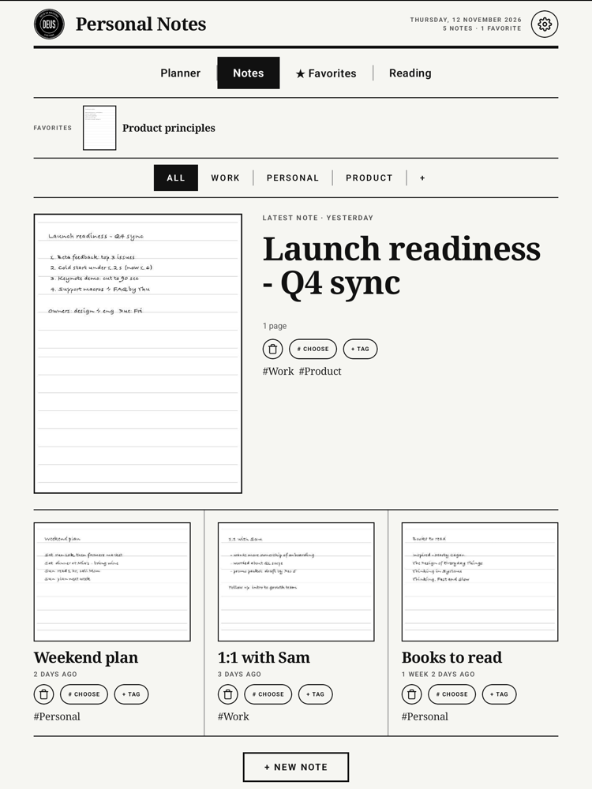
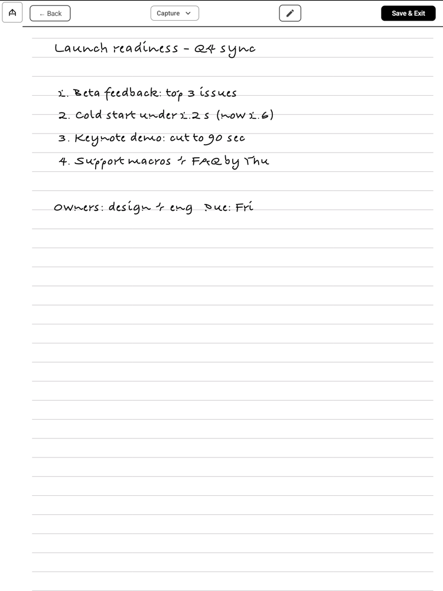

# DeusNotebook

**A handwriting notebook for Onyx Boox e-ink tablets.** Plan your week with a pen, capture thoughts as Markdown for
Obsidian, and keep an eye on your reading, all in one calm, black-and-white app built for a 10.3" e-ink screen.

No animation, no shadows, no gradients. Everything is drawn for high contrast and fast e-ink refresh.

<p align="center">
  
  
  
</p>

## What you can do with it

**Plan your week on paper that still thinks.**
The start page is a handwritten weekly planner: seven days as rows, five lines each, checkboxes you tick with the pen.
Tap a date to open that day's long to-do page. What you write on a day's first lines stays in sync with the week page.

**Capture a thought and send it to your vault.**
Write a page, tag it, press save. Handwriting recognition turns the strokes into text and the note lands in your
Obsidian inbox as Markdown with front matter, a rendered image of the page, and the full stroke data. Draw a box around a
word to turn it into a `[[wiki link]]` or a `#tag`.

**Be understood in two languages.**
A personal word list teaches the recogniser your names, projects and technical terms. Turkish and English mix freely
and Turkish letters (İ ı ş ğ ç ö ü) survive the whole trip, including file names and tags.

**Keep your notes in order.**
A newspaper-style Home shows your latest note large, the rest in a grid, topics as tabs, and favorites in their own tab.
Press and hold a note to pin it. Boox note names become topics automatically.

<p align="center">
  
</p>

**See your reading at a glance.**
The Reading tab is a dashboard that reads the Boox reader's own library and reading log: what you are reading now,
your streak, minutes per day, a year heat map, when you read, reading records, a yearly goal, highlights and a small
reading buddy. Tap a book and it opens in the Boox reader at the page you left.

<p align="center">
  
  
</p>

**A good pen and a quiet screen.**
Low-latency pen input through the Onyx Pen SDK, palm guard against a resting hand, undo and redo, selection, a ruler
tool and a pen button that switches tools.

## Everyday uses

- **Morning page.** Open the planner, write the day's three things, tick them off as the day goes.
- **Meeting notes.** One page per meeting, tagged with the project, saved straight into your vault.
- **Reading log without effort.** Read in the Boox reader as usual; the board keeps the streak and the yearly goal.
- **Research capture.** Annotate with boxes: link a person, tag a topic, and let the export turn it into graph links.
- **Review on the computer.** Notes arrive as Markdown, images and stroke files in one folder; sync it with Syncthing.

## Installation guide

**What you need:** an [Onyx Boox](https://www.boox.com/) tablet with Android 10 or newer (developed and tested on the
Go 10.3). The pen only works on Onyx hardware; other Android devices can open the app but cannot draw with the Onyx pen layer.

### Option 1: install the release APK (easiest)

1. On the tablet, open the [latest release](https://github.com/senihdal34/DeusNotebook/releases/latest) in the Boox browser
   and download `deusnotebook-<version>.apk`. Or download it on your computer and send it to the tablet with
   BOOXDrop, a USB cable (copy it to the `Download` folder) or any file-transfer app.
2. Open the Boox **Storage** (Depolama) app, go to `Download` and tap the APK.
3. The first time, Android asks to allow installs from this source. Tap **Settings**, switch **Allow from this source**
   on, go back and tap **Install**.
4. Open **A Deus Notebook** from the apps screen. The first-run page walks you through the rest (see below).

*Optional check:* the release is signed with this certificate (SHA-256):
`DC:64:3E:E0:F2:88:80:DC:AC:14:0C:5B:88:0A:92:2C:AE:77:77:C2:4A:B7:14:5E:A5:7E:AF:95:89:3E:A4:E8`.
Verify it with `apksigner verify --print-certs deusnotebook-<version>.apk`. A `.sha256` file with the checksum of the APK
is attached to every release.

### Option 2: install with a cable (adb)

Enable **Developer options** and **USB debugging** on the tablet, connect it, then:

```bash
adb install -r deusnotebook-<version>.apk
```

### Option 3: build from source

```bash
git clone https://github.com/senihdal34/DeusNotebook.git
cd DeusNotebook
./gradlew assembleDebug
adb install -r app/build/outputs/apk/debug/app-debug.apk
```

Requires JDK 17 and the Android SDK. The Onyx Maven repository is plain HTTP (`allowInsecureProtocol`), see
`settings.gradle`. Run the unit tests with `./gradlew testDebugUnitTest`. A debug build is signed with the shared debug
key in the repository, so it cannot be installed over a release build (and the other way round): uninstall first. Your
notes are not lost by that, see below.

### First run

The welcome page has six steps. Only file access is required.

1. **Language:** pick the app language and the language you write in by hand.
2. **File access:** allow "All files access" so notes and exports can be saved as normal files.
3. **Refresh mode:** switch the screen to HD or Regal for the sharpest ink.
4. **Keep it from freezing:** on the Boox home screen press and hold the app icon and choose "Unfreeze app".
   Otherwise the system may close the app in the background.
5. **Sync (optional):** set up Syncthing to send notes to your computer, see below. You can do it later in Settings, Sync.
6. **Quick guide:** gestures and tips.

### Updating, uninstalling, your data

- **Update:** download the newer APK and install it over the old one. Your notes stay. Settings, About shows the installed
  version, and Settings, General has "Check for newer version".
- **Where your notes live:** in the notebook database in `Documents/notabledb` and, once exported, as Markdown in
  `Documents/primary/inbox` (changeable in Settings). These folders are outside the app, so they survive an uninstall.
  Back them up before experimenting.
- **More handwriting languages:** English and Chinese come with the tablet. For other languages open Boox Notes, any note,
  the language button, "More languages", and download the pack.

### Troubleshooting

- *"App not installed"*: a different signature is already installed (a debug build, or another fork). Uninstall it first;
  your notes in `Documents/notabledb` remain.
- *The pen does not draw:* the Onyx pen layer only exists on Boox tablets.
- *The app closes by itself in the background:* do step 4 of the first run (Unfreeze app).

## Sync to your computer

Notes are written to `Documents/primary/inbox` (changeable in Settings). Share that folder with
[Syncthing](https://syncthing.net) and point Obsidian at it. A step-by-step guide is in Settings, Sync.

## Credits

DeusNotebook stands on other people's work, and gratefully so.

- **[Ethran/notable](https://github.com/Ethran/notable)**: the open-source note-taking app for Boox devices this
  project grew from. The editor, stroke storage and most of the plumbing are theirs.
- **[jdkruzr/aragonite](https://github.com/jdkruzr/aragonite)**: the fork that turned Notable into an Obsidian
  capture tool (inbox export, tags, annotation boxes, stroke container). The export pipeline here comes from it.
- **[BookOrbit](https://github.com/bookorbit/bookorbit)**: the Reading tab follows BookOrbit's Board: its page layout,
  tiles, badges and look. BookOrbit is licensed under AGPL-3.0; the Reading code here is a Kotlin port of that design.
- [Onyx Pen SDK](https://github.com/onyx-intl), [Jetpack Compose](https://developer.android.com/jetpack/compose),
  [Coil](https://coil-kt.github.io/coil/).

## License

DeusNotebook is free software under the **GNU Affero General Public License, version 3 only** (`AGPL-3.0-only`), see
[LICENSE](./LICENSE). Copyright (C) 2026 senihdal34 and DeusNotebook contributors.

**Why the AGPL.** The project combines code from three upstream projects, and the strictest of them decides:

| Upstream | Licence | Used for |
| --- | --- | --- |
| [Ethran/notable](https://github.com/Ethran/notable) | GPL-3.0 | editor, storage, import and export |
| [jdkruzr/aragonite](https://github.com/jdkruzr/aragonite) | GPL-3.0 | Obsidian capture, tags, handwriting recognition, sync |
| [bookorbit/bookorbit](https://github.com/bookorbit/bookorbit) | AGPL-3.0 only, plus [additional terms](./licenses/bookorbit/ADDITIONAL_TERMS.md) | the Reading tab (board, badges, chapters, buddy art) |

## Contributing

Pull requests are welcome. By contributing you agree that your contribution is licensed under the AGPL-3.0-only (and,
where it changes BookOrbit-derived files, under the additional terms above). Add
`// SPDX-License-Identifier: AGPL-3.0-only` to new Kotlin files and do not add code under a licence that is
incompatible with the AGPL.
