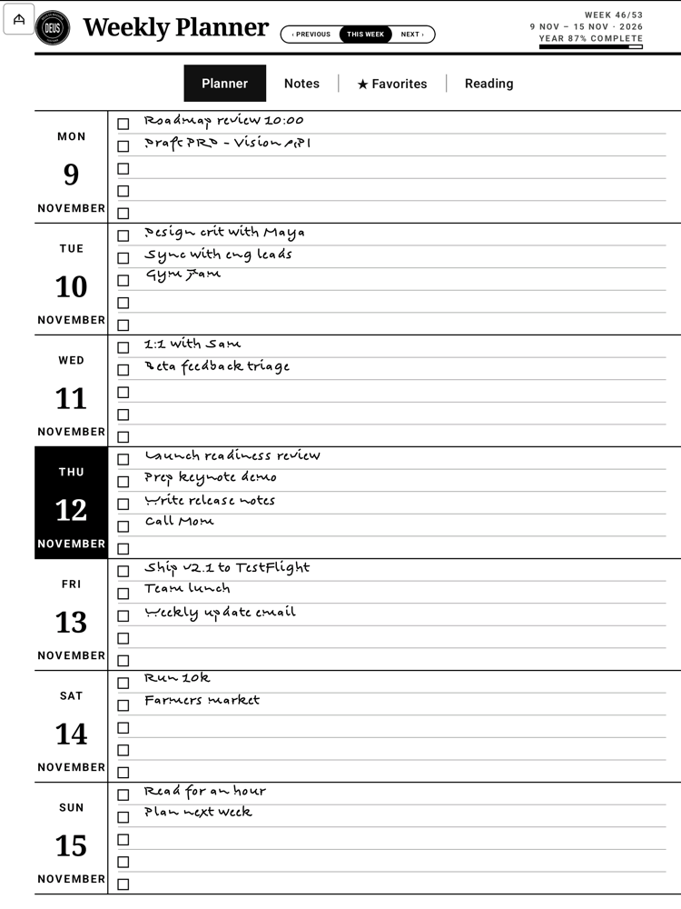
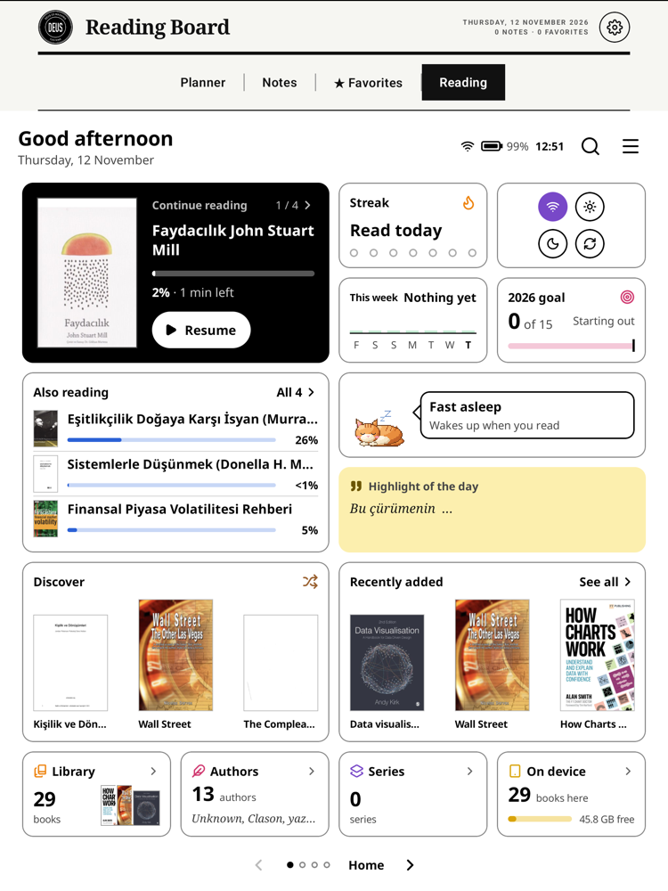
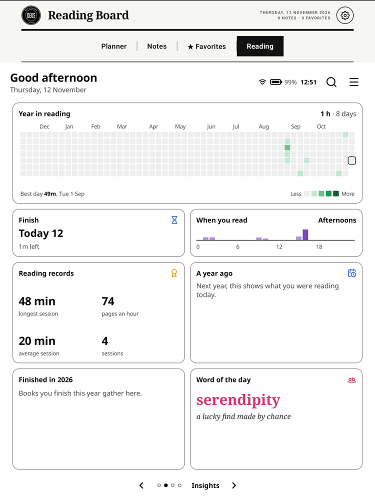
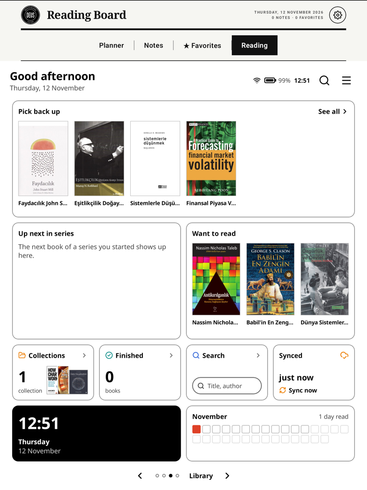

# DeusNotebook

**A handwriting notebook for Onyx Boox e-ink tablets.** Plan your week with a pen, capture thoughts as Markdown for
Obsidian, and keep an eye on your reading, all in one calm, black-and-white app built for a 10.3" e-ink screen.

No animation, no shadows, no gradients. Everything is drawn for high contrast and fast e-ink refresh.

<p align="center">
  
  
  
</p>

## What you can do with it

**Plan your week on paper that still thinks.**
The start page is a handwritten weekly planner: seven days as rows, five lines each, checkboxes you tick with the pen.
Tap a date to open that day's long to-do page. What you write on a day's first lines stays in sync with the week page.

**Capture a thought and send it to your vault.**
Write a page, tag it, press save. Handwriting recognition turns the strokes into text and the note lands in your
Obsidian inbox as Markdown with front matter, a rendered image of the page, and the full stroke data. Draw a box around a
word to turn it into a `[[wiki link]]` or a `#tag`.

**Be understood in two languages.**
A personal word list teaches the recogniser your names, projects and technical terms. Turkish and English mix freely
and Turkish letters (İ ı ş ğ ç ö ü) survive the whole trip, including file names and tags.

**Keep your notes in order.**
A newspaper-style Home shows your latest note large, the rest in a grid, topics as tabs, and favorites in their own tab.
Press and hold a note to pin it. Boox note names become topics automatically.

**See your reading at a glance.**
The Reading tab is a dashboard that reads the Boox reader's own library and reading log: what you are reading now,
your streak, minutes per day, a year heat map, when you read, reading records, a yearly goal, highlights and a small
reading buddy. Tap a book and it opens in the Boox reader at the page you left.

<p align="center">
  
</p>

**A good pen and a quiet screen.**
Low-latency pen input through the Onyx Pen SDK, palm guard against a resting hand, undo and redo, selection, a ruler
tool and a pen button that switches tools.

## Everyday uses

- **Morning page.** Open the planner, write the day's three things, tick them off as the day goes.
- **Meeting notes.** One page per meeting, tagged with the project, saved straight into your vault.
- **Reading log without effort.** Read in the Boox reader as usual; the board keeps the streak and the yearly goal.
- **Research capture.** Annotate with boxes: link a person, tag a topic, and let the export turn it into graph links.
- **Review on the computer.** Notes arrive as Markdown, images and stroke files in one folder; sync it with Syncthing.

## Install

```bash
./gradlew assembleDebug
adb install -r app/build/outputs/apk/debug/app-debug.apk
```

Requires JDK 17 and the Android SDK. The Onyx Maven repository is plain HTTP (`allowInsecureProtocol`), see
`settings.gradle`. Pen input only works on Onyx hardware; the rest runs on any Android 10+ device.
Run the unit tests with `./gradlew testDebugUnitTest`.

On first start grant file access. On Boox devices also long-press the app icon and choose "Unfreeze app" so the system
does not close it in the background.

## Sync to your computer

Notes are written to `Documents/primary/inbox` (changeable in Settings). Share that folder with
[Syncthing](https://syncthing.net) and point Obsidian at it. A step-by-step guide is in Settings, Sync.

## Credits

DeusNotebook stands on other people's work, and gratefully so.

- **[Ethran/notable](https://github.com/Ethran/notable)**: the open-source note-taking app for Boox devices this
  project grew from. The editor, stroke storage and most of the plumbing are theirs.
- **[jdkruzr/aragonite](https://github.com/jdkruzr/aragonite)**: the fork that turned Notable into an Obsidian
  capture tool (inbox export, tags, annotation boxes, stroke container). The export pipeline here comes from it.
- **[BookOrbit](https://github.com/bookorbit/bookorbit)**: the Reading tab follows BookOrbit's Board: its page layout,
  tiles, badges and look. BookOrbit is licensed under AGPL-3.0; the Reading code here is a Kotlin port of that design.
- [Onyx Pen SDK](https://github.com/onyx-intl), [Jetpack Compose](https://developer.android.com/jetpack/compose),
  [Coil](https://coil-kt.github.io/coil/).

## License

DeusNotebook is free software under the **GNU Affero General Public License, version 3 only** (`AGPL-3.0-only`), see
[LICENSE](./LICENSE). Copyright (C) 2026 senihdal34 and DeusNotebook contributors.

**Why the AGPL.** The project combines code from three upstream projects, and the strictest of them decides:

| Upstream | Licence | Used for |
| --- | --- | --- |
| [Ethran/notable](https://github.com/Ethran/notable) | GPL-3.0 | editor, storage, import and export |
| [jdkruzr/aragonite](https://github.com/jdkruzr/aragonite) | GPL-3.0 | Obsidian capture, tags, handwriting recognition, sync |
| [bookorbit/bookorbit](https://github.com/bookorbit/bookorbit) | AGPL-3.0 only, plus [additional terms](./licenses/bookorbit/ADDITIONAL_TERMS.md) | the Reading tab (board, badges, chapters, buddy art) |

GPL-3.0 code may be combined with AGPL-3.0 code (section 13 of both licences). The combined work is distributed under
the AGPL-3.0-only; the GPL parts keep their GPL terms (text in [licenses/GPL-3.0.txt](./licenses/GPL-3.0.txt)).
BookOrbit's additional terms apply to the parts derived from it. They require, among other things, an About screen with
the BookOrbit notice and a link to the complete source of the exact version you run: open **Settings, About and legal
notices**, or the menu of the Reading tab. If you distribute a modified version, keep that screen, keep
[NOTICE.md](./NOTICE.md) and `licenses/` and say what you changed and when. This is not an official BookOrbit release,
and the app does not use the BookOrbit name or logo as its own.

Where everything comes from: [NOTICE.md](./NOTICE.md) (upstream code and what was modified) and
[THIRD_PARTY_NOTICES.md](./THIRD_PARTY_NOTICES.md) (libraries, Noto fonts under the SIL Open Font License, Lucide icons).

**Onyx SDK caveat.** The Onyx Boox SDK (`onyxsdk-*`, also the `.aar` files in `app/libs`) is proprietary software of
Onyx International. It comes with the upstream projects, is not covered by the AGPL and is not part of this project's
source. Check Onyx's terms before you redistribute a build. One image, `iris.jpg`, has an unverified origin (see
THIRD_PARTY_NOTICES.md).

## Contributing

Pull requests are welcome. By contributing you agree that your contribution is licensed under the AGPL-3.0-only (and,
where it changes BookOrbit-derived files, under the additional terms above). Add
`// SPDX-License-Identifier: AGPL-3.0-only` to new Kotlin files and do not add code under a licence that is
incompatible with the AGPL.
